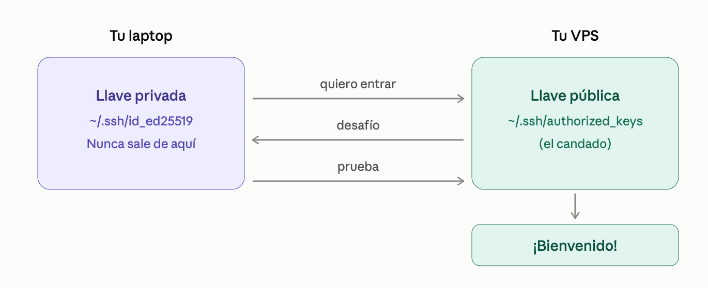

# De tu laptop a un servidor en la nube: VPS, Ubuntu y SSH desde cero

Al terminar este módulo vas a poder:

- Explicar qué es un VPS y en qué se diferencia de tu computadora.
- Moverte por el sistema de archivos de Linux sin perderte.
- Escribir comandos entendiendo qué hace cada parte.
- Conectarte a un servidor con SSH usando llaves, sin contraseñas.
- Trabajar sobre el servidor desde VS Code.
- Medir y optimizar la memoria RAM de Ubuntu en un servidor pequeño.

Cada tema se conecta con el siguiente: primero entiendes dónde vas a trabajar (VPS), luego cómo está organizado (archivos), cómo hablarle (comandos), cómo entrar (SSH), cómo trabajar cómodo (VS Code) y, al final, cómo cuidarlo (RAM).

## ¿Qué es un VPS?

### La analogía: un departamento en un edificio

Imagina un edificio enorme con muchos departamentos. El edificio es un servidor físico en un centro de datos. El administrador del edificio (el hipervisor) divide los recursos y le entrega a cada inquilino un departamento con sus propias llaves. Cada departamento es un VPS (*Virtual Private Server*): un servidor virtual que se comporta como una computadora completa, solo tuya.

```text
SERVIDOR FÍSICO (un edificio en un datacenter)
┌──────────────────────────────────────────────────┐
│  Hipervisor (el administrador del edificio)      │
│ ┌─────────────┐ ┌─────────────┐ ┌─────────────┐  │
│ │  VPS de A   │ │  VPS de B   │ │  TU VPS     │  │
│ │  1 vCPU     │ │  2 vCPU     │ │  1 vCPU     │  │
│ │  1 GB RAM   │ │  4 GB RAM   │ │  2 GB RAM   │  │
│ │  Ubuntu     │ │  Debian     │ │  Ubuntu     │  │
│ └─────────────┘ └─────────────┘ └─────────────┘  │
└──────────────────────────────────────────────────┘
```

### Radiografía de un plan de VPS

Cuando contrates uno, verás algo así. Cada parte significa algo concreto:

```text
Ubuntu 24.04 LTS · 1 vCPU · 2 GB RAM · 40 GB SSD · IPv4 pública
│                  │        │         │          └─ la dirección para encontrarlo
│                  │        │         └─ almacenamiento (tu "archivero")
│                  │        └─ memoria de trabajo
│                  └─ capacidad de cómputo
└─ sistema operativo (LTS = soporte a largo plazo)
```

¿Por qué le importa esto a un AI Engineer? Porque ahí vas a desplegar tus APIs, tus agentes y tus automatizaciones para que funcionen aunque tu laptop esté apagada.

> **PREGUNTAS**  
> - ¿cuál es la diferencia entre RAM y SSD?
> - nombra dos cosas que un VPS tiene y tu laptop normalmente no.

## El sistema de archivos de Linux


En Windows tienes `C:\`, `D:\`. En Linux todo cuelga de un único punto: la raíz, `/`. Es un árbol: una raíz y ramas que se abren en carpetas.

```text
/                      ← la raíz, el origen de todo
├── home/              ← las carpetas personales de cada usuario
│   └── deploy/        ← TU casa (aquí trabajas)
├── etc/               ← archivos de configuración del sistema
├── var/               ← datos que cambian: logs, bases de datos
│   └── log/           ← los registros ("qué pasó en el servidor")
├── usr/               ← programas instalados
├── bin/               ← comandos básicos (ls, cp, cat...)
├── tmp/               ← archivos temporales
└── root/              ← la casa del administrador
```

### Tres comandos para orientarte

```bash
pwd        # ¿Dónde estoy?
ls         # ¿Qué hay aquí?
cd         # Muévete a otra carpeta
```

### Antes y después de `cd`

```bash
$ pwd
/home/deploy

$ cd /var/log

$ pwd
/var/log
```

El comando no imprimió nada al moverte, pero tu ubicación cambió. Por eso `pwd` es tu brújula.

### Ruta absoluta vs. ruta relativa

| Tipo | Empieza con | Ejemplo | Significa |
| --- | --- | --- | --- |
| Absoluta | `/` | `cd /home/deploy/proyectos` | Desde la raíz, siempre funciona |
| Relativa | Nada | `cd proyectos` | Desde donde estás ahora |

Atajos útiles: `cd ~` (a tu casa), `cd ..` (un nivel hacia arriba), `cd -` (a donde estabas antes).

### Error que vas a ver (y que está bien)

```bash
$ nano /etc/ssh/sshd_config
Permission denied
```

No es un fallo: es Linux protegiendo la configuración del sistema. Para editarla necesitas permisos de administrador con `sudo`.

> **Pausa de recuperación 2**  
> - ¿Qué carpeta usarías para revisar por qué falló un servicio? 
> - Estás en `/var/log`. ¿Qué comando te lleva a tu casa? 
> - ¿`cd etc` y `cd /etc` hacen lo mismo? ¿Por qué?

**Mini-reto:** navega desde tu casa hasta `/var/log` usando una ruta relativa y luego regresa con `cd ~`. Haz `ls` en cada parada.

## Fundamentos de la línea de comandos

La terminal es una conversación: tú escribes una orden, el sistema responde. Todos los comandos siguen la misma gramática.

### Radiografía de un comando

```text
ls   -la   /var/log
│     │      │
│     │      └─ argumento: SOBRE QUÉ (la carpeta)
│     └─ opción: CÓMO (-l lista detallada, -a incluye ocultos)
└─ comando: QUÉ HACER
```

Cuando algo no te salga, aplica este patrón: qué + cómo + sobre qué.

### Los comandos que usarás todos los días

| Comando | Qué hace | Ejemplo |
| --- | --- | --- |
| `mkdir` | Crea una carpeta | `mkdir proyecto` |
| `touch` | Crea un archivo vacío | `touch notas.txt` |
| `cp` | Copia | `cp notas.txt copia.txt` |
| `mv` | Mueve o renombra | `mv copia.txt final.txt` |
| `rm` | Borra | `rm final.txt` |
| `cat` | Muestra un archivo | `cat notas.txt` |
| `less` | Lee un archivo largo (sales con `q`) | `less /var/log/syslog` |
| `nano` | Editor de texto simple | `nano notas.txt` |
| `grep` | Busca texto | `grep error archivo.log` |
| `sudo` | Ejecuta como administrador | `sudo apt update` |
| `--help / man` | Pide ayuda | `ls --help` |

### Construye algo, paso a paso

Escribe esto en tu terminal y observa la respuesta de cada línea:

```bash
mkdir proyecto            # crea la carpeta
cd proyecto               # entra en ella
touch notas.txt           # crea un archivo vacío
echo "hola servidor" > notas.txt   # escribe texto dentro del archivo
cat notas.txt             # lo muestra
hola servidor
```

El símbolo `>` redirige la salida: en vez de mostrarla en pantalla, la guarda en un archivo. Si usas `>>`, agrega al final en lugar de reemplazar.

### La tubería: encadenar comandos

El símbolo `|` toma la salida de un comando y la entrega al siguiente:

```bash
ls /etc | grep ssh
```

Leído en voz alta: “lista lo que hay en `/etc` y, de eso, muéstrame solo lo que contenga `ssh`”. Es la idea más poderosa de la terminal: piezas pequeñas que se combinan.

### Cuidado: no hay papelera

```bash
rm archivo.txt        # borrado inmediato y definitivo
rm -rf carpeta        # borra la carpeta y TODO su contenido sin preguntar
```

Antes de ejecutar `rm -rf`, haz `ls` de la ruta y relee el comando dos veces. Nunca ejecutes uno que no entiendas completo.

> **Pausa de recuperación 3**  
> - En `ls -la /var/log`, ¿qué es cada parte? 
> - ¿Qué diferencia hay entre `>` y `>>`?   
> - ¿Qué hace `cat /etc/os-release | grep VERSION`?

## SSH, la llave de tu servidor

SSH (*Secure Shell*) es el canal cifrado que te permite controlar tu VPS desde tu computadora, como si tuvieras su teclado enfrente.

### La analogía: candado y llave

Con autenticación por llaves creas un par:

- La llave privada: es tu llave. Se queda en tu laptop y nunca se comparte.
- La llave pública: es el candado. La copias al servidor y puedes compartirla sin riesgo.



El servidor te lanza un desafío que solo puede resolver quien tiene la llave privada correcta. Tu llave nunca viaja por la red.

### Contraseña vs. llave

| Aspecto | Contraseña | Llave SSH |
| --- | --- | --- |
| ¿Se puede adivinar? | Sí, por fuerza bruta | Prácticamente no |
| ¿Viaja por la red? | Sí | No, nunca |
| ¿Hay que teclearla? | Cada vez | No |
| Uso recomendado | Solo primer acceso | Siempre |

### Tu primera conexión

```bash
ssh usuario@203.0.113.10
```

La estructura es `ssh usuario@dirección-del-servidor`. La IP del ejemplo es ficticia; usa la de tu VPS.

La primera vez verás esta pregunta:

```text
The authenticity of host '203.0.113.10' can't be established.
ED25519 key fingerprint is SHA256:...
Are you sure you want to continue connecting (yes/no)?
```

SSH te pide que confirmes que ese servidor es el correcto. Responde `yes` y quedará registrado en `~/.ssh/known_hosts`.

### Crea y envía tu llave

```bash
ssh-keygen -t ed25519 -C "tu-email@ejemplo.com"   # 1. crea el par de llaves
ssh-copy-id usuario@203.0.113.10                   # 2. instala el candado en el servidor
ssh usuario@203.0.113.10                           # 3. entra sin contraseña
```

Cuando `ssh-keygen` te pregunte por una *passphrase*, te recomendamos poner una: protege tu llave si alguien accede a tu laptop.

### Errores comunes

| Mensaje | Qué significa | Qué hacer |
| --- | --- | --- |
| `Permission denied (publickey)` | El servidor no reconoce tu llave | Repite `ssh-copy-id` y verifica el usuario |
| `Connection timed out` | No llegas al servidor | Revisa la IP y que el VPS esté encendido |
| `REMOTE HOST IDENTIFICATION HAS CHANGED` | El servidor cambió de huella | Verifica si reinstalaste el VPS antes de seguir |
| `UNPROTECTED PRIVATE KEY FILE` | Tu llave tiene permisos muy abiertos | `chmod 600 ~/.ssh/id_ed25519` |

Regla de oro: comparte solo el archivo que termina en `.pub`. El archivo sin extensión es tu llave privada y no sale de tu máquina.

> **Pausa de recuperación 4**  
> (a) ¿Cuál llave va en el servidor y cuál se queda contigo? (b) ¿Por qué una llave es más segura que una contraseña? (c) Si ves `Permission denied (publickey)`, ¿cuál es tu primer paso?

## Trabajar en el VPS desde VS Code


Editar archivos con `nano` sirve para arreglos rápidos, pero para un proyecto real querrás tu editor de siempre. Con la extensión **Remote - SSH**, VS Code se conecta al VPS: el editor corre en tu laptop, pero los archivos y la terminal están en el servidor.

### Paso a paso

1. Instala la extensión **Remote - SSH** (publicada por Microsoft) desde el panel de extensiones.
2. Abre la paleta de comandos (`Ctrl+Shift+P` / `Cmd+Shift+P`) y ejecuta `Remote-SSH: Connect to Host…`
3. Escribe `usuario@203.0.113.10` o elige un host guardado.
4. Se abre una ventana nueva. Abajo a la izquierda verás el nombre del servidor.
5. Usa **File → Open Folder** para abrir una carpeta del VPS.

### Evita repetir datos: el archivo `~/.ssh/config`

En lugar de recordar IPs y usuarios, dale un apodo a tu servidor:

```text
Host mi-vps
    HostName 203.0.113.10
    User deploy
    IdentityFile ~/.ssh/id_ed25519
```

Antes: `ssh deploy@203.0.113.10`  
Después: `ssh mi-vps`

Y en VS Code, `mi-vps` aparecerá directamente en la lista de hosts.

### Qué cambia al trabajar remoto

| Terminal sola | VS Code Remote-SSH |
| --- | --- |
| `nano` | Editor completo con colores y búsqueda |
| `ls` y `cd` | Panel lateral con el árbol |
| La única ventana | Integrada (`Ctrl+ñ` o `Ctrl+~`) |
| No aplica | Se instalan en el servidor |

Un detalle importante: al conectarte, VS Code instala un pequeño componente de servidor en tu VPS y lo mantiene corriendo. En un servidor con poca memoria eso se nota. Es el puente perfecto hacia la siguiente parte.


## Optimizar Ubuntu para usar la RAM con eficiencia

Tu VPS tiene poca memoria, y ahora que sabes entrar y moverte, es momento de aprender a cuidarla.

### La analogía: escritorio, archivero y mesa auxiliar

- **RAM** = tu escritorio. Lo que tienes a mano está al instante, pero el espacio es limitado.
- **Disco** = el archivero. Cabe mucho, pero ir a buscar algo es lento.
- **Swap** = una mesa auxiliar que está dentro del archivero. Cuando el escritorio se llena, mueves cosas ahí. Evita que todo se caiga, pero es mucho más lenta que la RAM.

### Paso 1: Medir antes de tocar nada

```bash
free -h
               total   used   free   shared  buff/cache   available
Mem:           1.9Gi  612Mi  143Mi   1.0Mi       1.2Gi       1.2Gi
Swap:             0B     0B     0B
```

Radiografía de esta salida:

- `total`: la RAM que contrataste.
- `used`: la que usan tus programas.
- `free`: la que está totalmente vacía. Que sea baja es normal.
- `buff/cache`: memoria que Linux usa como caché para ir más rápido. La libera automáticamente si la necesitas.
- `available`: la cifra que importa: cuánta memoria puedes usar realmente.

Error típico de principiante: ver `free` bajo y asustarse. Mira siempre `available`.

### Paso 2: Descubrir quién consume

```bash
ps aux --sort=-%mem | head -n 6
```

Lista los procesos ordenados por uso de memoria y muestra solo los 5 primeros (más el encabezado). Fíjate en la columna `%MEM`. Para verlo en vivo, usa `top` (sales con `q`) o `htop` si lo tienes instalado.

### Paso 3: Apagar lo que no necesitas

```bash
systemctl list-units --type=service --state=running
```

Esto lista los servicios activos. Si encuentras uno que entiendes y no usas, puedes detenerlo y evitar que arranque con el sistema:

```bash
sudo systemctl disable --now nombre-del-servicio
```

> ⚠️ **Regla de seguridad:** nunca desactives algo que no sepas para qué sirve, y jamás toques `ssh`: si lo apagas, te quedas afuera de tu propio servidor. Ante la duda, investiga con `systemctl status nombre-del-servicio` o `man`.

### Paso 4: Agregar swap como colchón de seguridad

Si tu VPS no tiene swap (`Swap: 0B`), un pico de uso puede hacer que el sistema mate procesos. Crea un archivo de swap de 1 GB:

```bash
sudo fallocate -l 1G /swapfile      # reserva 1 GB en disco
sudo chmod 600 /swapfile            # solo el administrador puede leerlo
sudo mkswap /swapfile               # lo formatea como swap
sudo swapon /swapfile               # lo activa
```

Para que se active también al reiniciar, agrega esta línea a `/etc/fstab`:

```bash
echo '/swapfile none swap sw 0 0' | sudo tee -a /etc/fstab
```

Verifica el resultado:

```bash
free -h
               total   used   free   shared  buff/cache   available
Mem:           1.9Gi  612Mi  143Mi   1.0Mi       1.2Gi       1.2Gi
Swap:          1.0Gi     0B  1.0Gi
```

La fila `Swap` pasó de `0B` a `1.0Gi`: ya tienes colchón.

### Paso 5: Ajustar cuánto usa el swap

El parámetro `swappiness` (de 0 a 100) indica qué tan pronto Linux empieza a usar el swap. En servidores suele ser conveniente un valor bajo.

```bash
cat /proc/sys/vm/swappiness                 # ver el valor actual
sudo sysctl vm.swappiness=10                # cambiarlo ahora
echo 'vm.swappiness=10' | sudo tee /etc/sysctl.d/99-swappiness.conf   # mantenerlo tras reiniciar
```

### Antes y después (valores ilustrativos)

| Antes | Después |
| --- | --- |
| 0 B | 1 GB |
| Varios | Solo los que usas |
| El sistema puede cerrar procesos | Tiene margen de respiro |
| `free -h` | `free -h` y `ps aux --sort=-%mem` |

### Si algo se cerró solo

Cuando se agota la memoria, Linux activa el OOM killer y mata procesos para sobrevivir. Para confirmarlo:

```bash
sudo dmesg | grep -i -E "out of memory|killed process"
```

> **Pausa de recuperación 6**  
> (a) ¿Qué columna de `free -h` te dice cuánta memoria puedes usar realmente? (b) ¿Por qué el swap no reemplaza a la RAM? (c) ¿Por qué nunca debes desactivar el servicio `ssh`?


