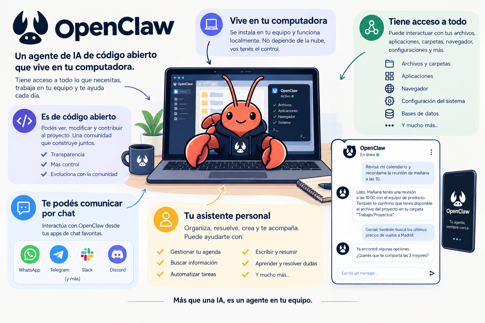

# Basic personal assistants with OpenClaw: del chatbot al agente personal

> **Antes de empezar:** OpenClaw evoluciona rápidamente. Los comandos de este artículo siguen la documentación oficial (docs.openclaw.ai) al momento de redactarlo. Si algo difiere en la versión utilizada, la documentación oficial es la referencia.

## Introducción a OpenClaw

Hasta ahora, los asistentes de IA se usaban así: se abre una pestaña, se escribe, se espera una respuesta y se cierra. El asistente solo existe mientras se le habla. OpenClaw plantea otra idea: ¿y si el asistente viviera donde ya se comunica el usuario (WhatsApp, Telegram, Discord, Slack), recordara lo que se habló y pudiera hacer cosas en la computadora aunque no se estuviera mirando?



## Radiografía de OpenClaw

A continuación, se analiza el sistema como una radiografía, pieza por pieza.

```
  TU CELULAR / TU PC
  ┌──────────────────┐
  │ ① CANAL          │  WhatsApp, Telegram, Discord, Slack...
  │ (donde se escribe) │
  └────────┬─────────┘
           │ mensaje
           ▼
  ┌──────────────────────────────────────────┐
  │ ② GATEWAY  (puerto 18789, tu máquina)    │
  │  recibe, enruta y maneja sesiones         │
  │        │                                 │
  │        ▼                                 │
  │ ③ AGENTE ──► ④ MODELO (Claude, GPT...)   │
  │        │      (el "cerebro" por API)     │
  │        ▼                                 │
  │ ⑤ WORKSPACE + SKILLS + HERRAMIENTAS      │
  │    archivos, memoria, acciones           │
  └──────────────────────────────────────────┘
```

| # | Pieza | Qué hace | Analogía |
|---|---|---|---|
| ① | **Canal** | Es la puerta de entrada: el chat donde se escribe | El mostrador de atención |
| ② | **Gateway** | Proceso siempre activo que recibe mensajes y los enruta | La recepcionista |
| ③ | **Agente** | La lógica que decide qué hacer con cada pedido | El asistente en sí |
| ④ | **Modelo** | El LLM al que se consulta por API; OpenClaw no está atado a un único modelo | El razonamiento |
| ⑤ | **Workspace y skills** | Carpeta con archivos de personalidad, memoria y capacidades instalables | El escritorio y las herramientas |

**Punto clave:** OpenClaw no es un modelo de IA. Es la infraestructura que rodea a un modelo para convertirlo en un asistente que persiste, recuerda y actúa. El costo de uso proviene del consumo de la API del modelo elegido.

## El workspace por dentro

El workspace es una carpeta (por defecto `~/.openclaw/workspace`) con archivos de texto plano que definen quién es el agente. Esto es lo más interesante desde el punto de vista pedagógico: **la personalidad y la memoria son archivos que se pueden leer y editar**.

```
~/.openclaw/
├── openclaw.json        ← configuración principal
└── workspace/
    ├── SOUL.md          ← personalidad y tono
    ├── AGENTS.md        ← instrucciones de comportamiento
    ├── MEMORY.md        ← memoria de largo plazo
    └── (otros: IDENTITY, USER, TOOLS, BOOTSTRAP...)
```

| Archivo | Pregunta que responde | Si se edita... |
|---|---|---|
| `SOUL.md` | ¿Cómo habla y qué valores tiene? | Cambia el tono y el estilo |
| `AGENTS.md` | ¿Qué reglas sigue? | Cambia lo que hace o evita hacer |
| `MEMORY.md` | ¿Qué recuerda de mí? | Cambia su conocimiento sobre el usuario |

Esto conecta con algo que ya se trabajó en el curso: un *prompt de sistema* es texto que orienta al modelo. Aquí ese texto está organizado en archivos persistentes, versionables y editables.


# Setting Up Your Personal AI Assistant

**Primero, un acuerdo de seguridad.** Un agente con acceso a archivos y comandos es potente, y por eso es necesario ser cuidadoso desde el primer minuto. Las guías de la comunidad coinciden en un consejo: **no se debe instalar en una computadora de uso diario con datos personales o de trabajo**. Las opciones más seguras son una máquina separada, una máquina virtual o un servidor aislado, o una versión hospedada.

| Entorno | Riesgo | Recomendado para esta clase |
|---|---|---|
| Tu laptop principal con todos tus archivos | Alto | No |
| Una máquina virtual o un VPS dedicado | Bajo | Sí |
| Una computadora secundaria sin datos sensibles | Bajo | Sí |

**Reglas del acuerdo:**

- Usar cuentas y claves de API *de prueba*, con límite de gasto.
- No conectar correo ni archivos reales en esta etapa.
- Mantener el Gateway accesible solo desde la propia máquina (el modo por defecto, *loopback*).

## Requisitos previos

- Node.js instalado (el Gateway corre sobre Node).
- Una terminal (macOS, Linux o Windows con WSL2; el soporte nativo en Windows es limitado).
- Una clave de API de un proveedor de modelos.
- Una app de mensajería de prueba (Telegram suele ser la más simple de configurar).

## El recorrido de instalación en 4 pasos

**Paso 1: Instalar**

```bash
npm install -g openclaw@latest
```

**Paso 2: Ejecutar el asistente de configuración**

```bash
openclaw onboard --install-daemon
```

Este asistente interactivo configura todo en orden. La opción `--install-daemon` registra el Gateway como servicio en segundo plano para que se inicie solo con la máquina.

**Paso 3: Verificar que el Gateway esté activo**

```bash
openclaw gateway status
openclaw status
openclaw health
```

**Paso 4: Abrir el panel y enviar el primer mensaje**

```bash
openclaw dashboard
```

Desde allí, o desde el canal conectado, se envía un saludo al agente.

## Qué pregunta el asistente de configuración (y por qué)

Cada pregunta del wizard corresponde a una pieza de la radiografía que ya se estudió:

| Lo que se ve en el wizard | Pieza que configura | Qué decidir |
|---|---|---|
| Elegir proveedor de IA y credenciales | ④ Modelo | Qué modelo usar y con qué clave |
| Ubicación del workspace | ⑤ Workspace | Dejar la ruta por defecto |
| Puerto, *bind* y autenticación del Gateway | ② Gateway | Mantener el puerto por defecto, loopback y token |
| Elegir app de mensajería | ① Canal | Una sola, de prueba |
| Revisar skills incluidas | ⑤ Skills | Instalar solo las que se entiendan |
| Instalar como servicio | ② Gateway | Opcional, pero conveniente |

El asistente genera por defecto un token de autenticación para el Gateway, incluso en modo local. Es una capa de protección: se acepta.

## Estados comparados: ¿funciona o no?

Cuando algo falla, comparar el estado esperado con el estado real indica dónde revisar.

| Síntoma | Estado esperado | Estado con problema | Qué revisar |
|---|---|---|---|
| `openclaw health` informa que no hay autenticación configurada | Credencial del proveedor cargada | El agente no puede responder | Volver al wizard y cargar la clave |
| El navegador muestra un error al abrir el panel | Gateway corriendo | Gateway detenido | Ejecutar `openclaw gateway` y revisar `openclaw status` |
| Se escribe en el canal y no hay respuesta | Canal vinculado y aprobado | Falta el emparejamiento (*pairing*) | `openclaw pairing list <canal>` y aprobar el código |
| Errores raros al arrancar | Configuración válida | Configuración inválida o heredada | `openclaw doctor` |

`openclaw doctor` es una herramienta útil: comprueba la versión de Node, la sintaxis de la configuración, el acceso al proveedor, el puerto del Gateway y el estado del servicio.

## Dale personalidad: antes y después

Se abre `~/.openclaw/workspace/SOUL.md` y se modifica. Se observa el contraste:

**Antes** (personalidad genérica): el agente responde de forma neutra y larga.

**Después** (con la edición):

```markdown
# SOUL.md

Sos un asistente de estudio para una persona que aprende programación.
- Respondé en español neutral, con frases cortas.
- Explicá con un ejemplo antes de dar la teoría.
- Si no estás segura de algo, decilo en lugar de inventar.
- Antes de ejecutar cualquier comando en la máquina, pedí confirmación.
```

Se envía la misma pregunta antes y después del cambio y se comparan las respuestas en clase. Cada línea del archivo tiene un efecto observable:

| Línea en SOUL.md | Efecto visible en la respuesta |
|---|---|
| «español neutral» | Cambia el idioma y el registro |
| «frases cortas» | Respuestas más breves |
| «un ejemplo antes de la teoría» | Cambia el orden de la explicación |
| «pedí confirmación» | El agente pausa antes de actuar (la línea más importante) |


## Errores frecuentes

| Error | Por qué pasa | Cómo evitarlo |
|---|---|---|
| Instalarlo en la laptop principal | Comodidad | Usar una VM o un servidor aislado |
| Confundir `openclaw setup` con una verificación | Ese comando inicializa o reinicia la configuración y el workspace | Para verificar, usar `status`, `health` o `doctor` |
| Instalar muchas skills sin leerlas | Curiosidad | Instalar de a una y leer qué hace cada una |
| Dar permisos amplios desde el inicio | Querer «ver todo lo que puede» | Empezar con lo mínimo y ampliar |
| Olvidar el límite de gasto en la API | El agente hace llamadas continuas | Configurar un tope en el panel del proveedor |

## Para seguir explorando

- Documentación oficial: [docs.openclaw.ai](https://docs.openclaw.ai/) (guía de inicio, referencia del wizard y del workspace).
- Repositorio del proyecto: [github.com/openclaw/openclaw](https://github.com/openclaw/openclaw).