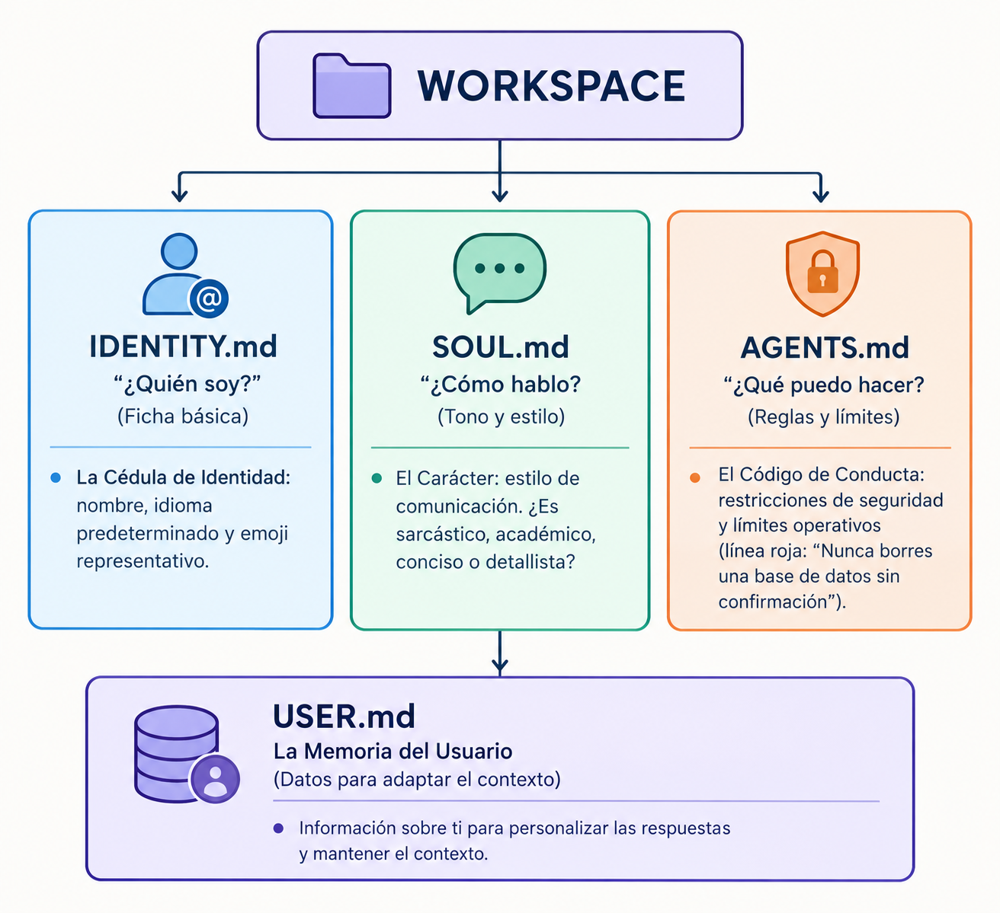

# OpenClaw Avanzado: Anatomía de un Agente y Adquisición de Habilidades

No pienses en OpenClaw como un programa abstracto; piénsalo como un organismo biológico digital hecho de archivos de texto. Hoy vas a abrir su "código genético".

Al finalizar este capítulo serás capaz de:

- Navegar la estructura física de OpenClaw en un entorno Linux.
- Diferenciar el núcleo del sistema (`~/.openclaw`) del entorno ejecutable (`~/workspace`).
- Modificar la personalidad y reglas del agente alterando archivos Markdown en tiempo real.
- Construir una habilidad (Skill) funcional con la arquitectura estándar `SKILL.md`.

## La "Anatomía" del Agente: Del Concepto al Archivo

En ingeniería de IA, las instrucciones son código. Todo lo que condiciona la respuesta de un LLM en OpenClaw reside en archivos de texto plano.

### Mapa de la Mente: Los dos hemisferios del servidor

Cuando entras a tu servidor VPS, la instalación se divide en dos grandes "casas":

```bash
~/.openclaw/                      ← [EL SISTEMA / EL CUERPO]
├── openclaw.json                 (Configuración global, puertos, claves)
├── credentials/                  (Claves API - ¡Nivel de seguridad crítico!)
└── workspace/                    ← [LA MENTE / EL AGENTE]
    ├── IDENTITY.md
    ├── SOUL.md
    ├── AGENTS.md
    └── skills/
```

| Ubicación | Analogía Biológica | ¿Qué contiene? | ¿Se edita a mano? |
| --- | --- | --- | --- |
| `~/.openclaw/` | El Sistema Nervioso | Configuración de red, logs, llaves de API, credenciales. | ⚠️ Solo en configuraciones avanzadas. |
| `~/.openclaw/workspace/` | La Corteza Cerebral | Personalidad, memoria, reglas de conducta y habilidades. | ✏️ Sí, es tu área de trabajo principal. |

> 🔒 Alerta de Seguridad: La carpeta `credentials/` contiene credenciales sensibles. Nunca expongas su contenido en repositorios públicos ni capturas de pantalla.

### Los 4 Archivos Esenciales del Workspace

En lugar de memorizar todo, enfócate en los cuatro pilares que definen el comportamiento de tu agente:




## Versionado Seguro: ¿Cómo y dónde crear tu repositorio Git?

Como IA Engineer, respaldarás la mente de tu agente en repositorios (GitHub, GitLab, etc.). Para hacerlo de forma segura, aplica esta regla de oro:

📌 Regla de Oro: el repositorio Git se inicializa ÚNICAMENTE dentro de `~/.openclaw/workspace/`, jamás en la raíz `~/.openclaw/`.

- `~/.openclaw/workspace/` (SÍ se versiona): es la corteza cerebral (texto plano, habilidades y reglas).
- `~/.openclaw/` (NO se versiona): contiene bases de datos locales, registros del sistema y la carpeta `credentials/` con tus llaves de API.

### El archivo `.gitignore` imprescindible

Incluso dentro de `workspace/`, debes excluir la memoria privada y temporales. Crea el archivo `~/.openclaw/workspace/.gitignore` con la siguiente estructura:

```gitignore
# Archivos de memoria sensible y datos personales del usuario
MEMORY.md
memory/
USER.md

# Archivos temporales, respaldos y copias de edición
*.bak
*.tmp
*.log
.DS_Store

# Entornos virtuales o dependencias que puedas generar en tus skills
node_modules/
venv/
.env
__pycache__/

# Claves o secretos que por error se hayan creado en el workspace
*.json
!skills/**/package.json
```

### ¿Qué archivos SÍ suben a tu repositorio?

- `IDENTITY.md`
- `SOUL.md`
- `AGENTS.md`
- `skills/` (Tus habilidades personalizadas)
- `.gitignore`

## Práctica 1: Modificación Genética en Vivo

### Accede al entorno

```bash
cd ~/.openclaw/workspace
ls -la
```

### Lee la personalidad actual

```bash
cat SOUL.md
```

### Aplica un cambio de conducta

Haz un respaldo rápido y edita el archivo:

```bash
cp SOUL.md SOUL.md.bak
nano SOUL.md
```

Agrega esta regla al final:

```text
Responde siempre como si fueras un pirata del siglo XVII.
```

### Prueba el cambio

Inicia una nueva sesión con tu agente y hazle una pregunta.

### Restaura el estado

```bash
mv SOUL.md.bak SOUL.md
```

## Enseñando Habilidades (Skills)

Una Skill es un módulo de instrucciones que le enseña al agente cómo resolver un problema específico usando sus herramientas.

### 1. Anatomía de una Skill (`SKILL.md`)

Las habilidades se guardan dentro de carpetas individuales en `workspace/skills/`:

```text
workspace/skills/resumen-diario/
├── SKILL.md          ← [Obligatorio] Instrucciones de la habilidad
├── scripts/          ← [Opcional] Código ejecutable (Python, Bash)
└── references/       ← [Opcional] Documentación de apoyo
```

Un archivo `SKILL.md` consta de dos partes:

```markdown
---
name: resumen-diario
description: Genera un resumen organizado del día y ayuda a establecer prioridades. Actívala cuando el usuario solicite un "resumen del día", "plan de hoy", "organizar mi día" o expresiones equivalentes.
---

# Skill: Resumen diario

## Objetivo
Ayudar al usuario a organizar su jornada, identificar prioridades y visualizar las tareas pendientes.

## Procedimiento

1. Revisa el contexto disponible de la conversación para identificar compromisos, tareas y prioridades mencionadas.
2. Si no hay prioridades identificadas, pregunta al usuario cuáles son sus tres prioridades del día.
3. Si el usuario proporciona menos de tres prioridades, trabaja con las disponibles. No inventes tareas para completar la lista.
4. Organiza las prioridades según su importancia y urgencia, sin modificar el objetivo original del usuario.
5. Identifica posibles tareas pendientes o compromisos relevantes, diferenciándolos de las prioridades confirmadas.
6. Presenta el resultado de forma breve y accionable.

## Formato de respuesta

**Resumen del día**
- Prioridad 1:
- Prioridad 2:
- Prioridad 3:

**Enfoque**
- Próxima acción recomendada.

## Reglas

- Utiliza viñetas claras.
- Mantén la respuesta por debajo de 80 palabras.
- No inventes compromisos, horarios ni tareas.
- No asumas que una tarea está terminada sin confirmación.
- Si falta información esencial, realiza una pregunta concreta antes de elaborar el resumen.
```

> 💡 Regla de Oro en IA: La etiqueta `description` dentro de los metadatos (`---`) es la clave de activación (trigger). Si la descripción es ambigua, el orquestador de la IA no sabrá cuándo usar la habilidad.

### 2. Orden de Prioridad de Skills

Si existen varias habilidades con el mismo nombre, OpenClaw aplica la siguiente jerarquía de resolución:

```text
[1. Workspace] (~/.openclaw/workspace/skills/)  ➜ Máxima Prioridad (Sobrescribe)
       ▲
[2. Sistema Local] (~/.openclaw/skills/)        ➜ Prioridad Media
       ▲
[3. Skills Embebidas] (Core OpenClaw)           ➜ Prioridad Base
```

## 🧪 Práctica 2: Tu Primera Skill desde Cero

### Crea la estructura de carpetas

```bash
mkdir -p ~/.openclaw/workspace/skills/resumen-diario
```

### Crea el archivo ejecutable

```bash
nano ~/.openclaw/workspace/skills/resumen-diario/SKILL.md
```

(Pega la plantilla vista en la sección 1.)

### Verifica el registro en el sistema

```bash
openclaw skills list
```

### Ejecuta la prueba de integración

Abre tu interfaz de chat con OpenClaw y escribe:

```text
Hola, dame mi resumen del día.
```

## Canales, Privacidad y Aislamiento de Memoria

OpenClaw puede conectarse a plataformas como Telegram, Slack, etc. Para evitar filtraciones indeseadas de datos, utiliza un sistema de carga contextual selectiva según el tipo de canal.

| Tipo de canal | Carga de contexto | Archivos incluidos |
| --- | --- | --- |
| Mensaje Directo (DM) | Contexto completo | `IDENTITY.md`, `SOUL.md`, `AGENTS.md`, `USER.md`, `MEMORY.md` |
| Chat Grupal | Solo archivos públicos | `IDENTITY.md`, `SOUL.md`, `AGENTS.md`, `USER.md` |

### 1. Carga Selectiva del Workspace

En Mensajes Directos (DM): El agente carga todo el contexto, incluyendo `MEMORY.md`. Esto le permite responder de forma hiperpersonalizada recordando tus preferencias pasadas.

En Chats Grupales: Si agregas tu bot a un grupo (por ejemplo, en Telegram), OpenClaw excluye deliberadamente `MEMORY.md`. El agente responderá normalmente basándose en su personalidad (`SOUL.md`), pero no revelará ni utilizará tus notas privadas ni preferencias personales frente a otros miembros del grupo.

### 2. Aislamiento de Sesiones con `session.dmScope`

Además de filtrar archivos, OpenClaw particiona las conversaciones para que las sesiones no se crucen. Esto se define en `openclaw.json`:

```json
{
  "session": {
    "dmScope": "per-channel-peer"
  }
}
```

- `per-channel-peer` (por defecto): Cada usuario en cada canal obtiene un espacio de memoria totalmente aislado. Ningún contexto se mezcla entre usuarios, incluso en canales compartidos.
- `per-account-channel-peer`: Aplica un aislamiento estricto por cuenta, canal y usuario, ideal si administras múltiples cuentas o clientes en una misma instancia.

> 🛡️ Control de Acceso: Mientras `dmScope` decide qué recuerda el agente para cada usuario, las listas de permisos y el emparejamiento (`pairing`) controlan quién tiene autorización para enviarle comandos en cada canal.

## Diagnóstico y Telemetría del Agente

Como futuros IA Engineers, no basta con que el agente funcione; deben saber monitorearlo, protegerlo y repararlo cuando falle.

### 1. Diagnóstico del Agente: `openclaw doctor`

Cuando tu agente no responda o falle al invocar herramientas, ejecuta el escáner médico de la infraestructura:

```bash
openclaw doctor
```

Revisa de forma automatizada la integridad de `openclaw.json`, permisos de archivos, validez de llaves de API y conectividad de red.

### 2. Sondeos de Gateway y Estado

Para auditar la latencia y confirmar que el puente de comunicaciones está escuchando peticiones:

```bash
openclaw gateway status
```

Esto te permite realizar un chequeo de salud (`health check`) rápido de los servicios en segundo plano antes de desplegar tu agente a usuarios finales.